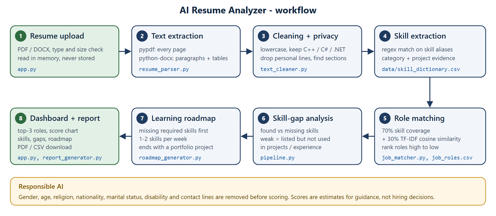

# AI Resume Analyzer & Job Recommendation System

**Live app:** https://nand-resume-analyzer.streamlit.app/ &nbsp;|&nbsp;
**Report:** [docs/Project_Report.pdf](docs/Project_Report.pdf) &nbsp;|&nbsp;
**Demo video:** [docs/demo.mp4](docs/demo.mp4)

An NLP-based Streamlit app that shows students how well their resume matches common tech roles.
Upload a PDF or DOCX resume and the app:

- extracts and cleans the text (keeping skill symbols like C++, C#, .NET)
- finds skills from a controlled dictionary of **76 skills in 10 categories**
- scores the resume against **9 job roles** and recommends the **top 3**
- lists **found, missing and weak skills** for any target role
- builds a **week-by-week learning roadmap**
- produces a downloadable **PDF report**

> Scores are estimates for guidance, not hiring decisions. Personal details are removed before scoring.



## Quick start

```bash
git clone <your-repo-url>
cd ai_resume_analyzer
python -m venv .venv
.venv\Scripts\activate          # Windows  (macOS/Linux: source .venv/bin/activate)
pip install -r requirements.txt
streamlit run app.py
```

Open http://localhost:8501, then upload a resume or pick one of the anonymised samples.

Python 3.10 or newer is required.

## How to use

1. **Upload** a PDF or DOCX resume (max 5 MB), or choose a sample from `data/sample_resumes/`.
2. *(Optional)* Paste a **job description**. Its skills become an extra "Custom job description" role.
3. Pick a **target role**. It defaults to your best match.
4. Explore the tabs: **Recommended roles**, **Extracted skills**, **Skill gap**, **Learning roadmap**, **Report**.

## How the match score works

```
match score = 70% x skill coverage + 30% x text similarity
```

| Part | What it measures |
|---|---|
| **Skill coverage** | Share of the role's skills found in the resume. Required skills count 1, nice-to-have skills count 0.5. |
| **Text similarity** | Cosine similarity between TF-IDF vectors of the cleaned resume and the role profile (description + skills + skill aliases). Uses unigrams and bigrams, English stop words removed, sublinear term frequency. |

Skill coverage carries most of the weight because it is easy to explain ("you have 6 of 7 required skills").
Text similarity rewards related wording the dictionary does not list.
A resume that has every skill still scores about 75-85%, because its wording never matches the role text exactly.

**Weak skills** are skills listed on the resume that never appear in the Projects or Experience sections.

## Project structure

```
ai_resume_analyzer/
|-- app.py                  Streamlit dashboard
|-- pipeline.py             runs the full analysis for one resume
|-- resume_parser.py        file validation + PDF/DOCX text extraction
|-- text_cleaner.py         cleaning, personal-info removal, section detection
|-- skill_extractor.py      dictionary skill matching, education, experience
|-- job_matcher.py          TF-IDF + coverage scoring, role ranking
|-- roadmap_generator.py    rule-based learning roadmap
|-- report_generator.py     PDF report
|-- requirements.txt
|-- .env.example            only for the optional LLM extension
|-- data/
|   |-- job_roles.csv       9 roles: required + nice-to-have skills, description
|   |-- skill_dictionary.csv  76 skills: category, aliases, learning topic
|   |-- sample_resumes/     5 anonymised resumes (3 PDF, 2 DOCX)
|-- reports/                reports saved only if the user ticks the box
|-- docs/
|   |-- architecture.png    workflow diagram
|   |-- Project_Report.pdf  short project report
|   |-- demo.mp4            2-minute demonstration video
|   |-- screenshots/        app screenshots
|-- tests/
    |-- run_tests.py        evaluation script
    |-- test_cases.csv      expected vs actual top role
    |-- make_sample_resumes.py
```

## Datasets

**`data/job_roles.csv`** covers Data Analyst, Data Scientist, Machine Learning Engineer, AI Engineer, NLP Engineer, Computer Vision Engineer, Python Developer, Web Developer, and Cloud & DevOps Engineer.
Each role lists its core skills first, and the roadmap uses that order as priority.

**`data/skill_dictionary.csv`** gives each skill a category, the aliases that detect it, and a learning topic used in the roadmap.
Examples: `scikit-learn | sklearn | scikit learn` and `CNN | convolutional neural network | resnet`.
To add a skill, add a row. To add a role, add a row to `job_roles.csv` that uses skill names from the dictionary.

## Testing

```bash
python tests/run_tests.py
```

| Check | Result |
|---|---|
| Text extracted from all 5 samples (PDF and DOCX) | Pass |
| Expected top role = actual top role | **5 / 5** |
| Skill precision / recall on the samples | **0.97 / 1.00** |
| C++, C#, .NET, Node.js, CI/CD kept as skills; no "ml" match inside "html" | Pass |
| Adding role skills raises the score; unrelated skills don't change coverage | Pass |
| Gender, DOB, marital status, religion, nationality and email lines change no score | Pass |
| Rejects .txt, empty, corrupt and over-5 MB files | Pass |

| Test resume | Expected top role | Actual top role | Score |
|---|---|---|---|
| Resume A | Data Analyst | Data Analyst | 78% |
| Resume B | Machine Learning Engineer | Machine Learning Engineer | 70% |
| Resume C | NLP Engineer | NLP Engineer | 80% |
| Resume D | Computer Vision Engineer | Computer Vision Engineer | 81% |
| Resume E | Web Developer | Web Developer | 77% |

The only extra skill was "Classification" on resumes C and D.
It was triggered by "text classification" and "image classification", which is arguably correct.
Full details are in `tests/test_cases.csv`.

## Responsible AI

- The tool gives guidance only; it does not make automatic hiring or rejection decisions.
- Lines mentioning gender, age, date of birth, religion, nationality, caste, marital status, disability or photograph are dropped before scoring, along with email and phone lines. URLs are masked.
- Only job-related skills, education, projects and experience are evaluated.
- Resumes are read in memory and never written to disk. Reports are saved only if the user asks.
- The app reminds users that a missing keyword does not always mean a missing ability.

## Limitations

- **Keyword matching misses unlisted wording.** A skill described in words that are not in the dictionary (e.g. "built neural nets") is not detected. Sentence Transformers would catch these semantically.
- **The dictionary and role list are hand-made.** They reflect common requirements, not live job-market data.
- **Scanned (image-only) PDFs** have no text layer, so they are rejected. OCR would be needed.
- **Section detection uses common headings**, so unusual headings are not recognised.
- **Weights are set by hand.** The 70/30 weights were not learned, because no labelled resume-to-role dataset was available.

## Deployment (Streamlit Community Cloud)

Deployed at https://nand-resume-analyzer.streamlit.app/. To deploy your own copy:

1. Push this folder to a public GitHub repository.
2. Go to share.streamlit.io, choose **New app**, select the repo and set the main file to `app.py`.
3. Deploy. `requirements.txt` is installed automatically. No secrets are needed.

## Possible extensions

- Sentence-Transformers semantic matching (`all-MiniLM-L6-v2`) as an alternative to TF-IDF
- LLM-generated resume feedback with a controlled prompt (key in `.env`)
- FastAPI backend + Docker image; saved reports with SQLite and user login
